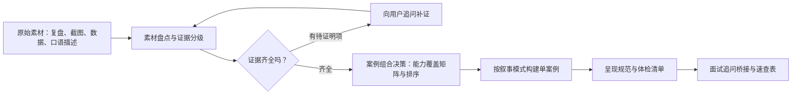

# 案例锻造官（Case Forge）

> English: An agent skill that forges a designer's raw project material into portfolio case studies and interview-ready narratives — evidence grading, case portfolio decisions, narrative pattern selection, and interviewer follow-up preparation, with hard gates against fabrication and template writing.

一个面向产品设计师、UX/UI 设计师的 Agent Skill。它不把项目经历套进模板，而是先把素材做证据分级，再决定案例组合，最后用匹配的叙事模式构建案例，并为每个案例生成面试追问预案。

## 它解决什么问题

准备作品集时，常见的问题不是"不会排版"，而是：

- 素材很多，但分不清哪些有证据、哪些只是印象里发生过。
- 每个案例都写成"调研 → 原型 → 上线"的流程流水账，看不出个人判断。
- 数据写了，但被面试官追问口径时答不上来。
- 三个案例同一个叙事结构，模板感明显。
- 案例写完了，但没准备过面试官的深挖追问。

案例锻造官把这些问题组织成一条带硬性门禁的工作流。

## 核心工作流



### 1. 素材盘点与证据分级

- 每条材料分为：已证明 / 待证明 / 可迁移 / 缺口。
- 事实来源三分：公开事实、个人事实、分析推断，永不混写。
- 硬性门禁：未完成盘点，不得开始任何叙事写作。

### 2. 案例组合决策

- 项目 × 能力覆盖矩阵，先决定论证结构再写案例。
- 深度案例默认不超过 3 个；排序按"证明核心价值 → 补齐覆盖 → 留下成长印象"。

### 3. 叙事模式库

四种模式按项目实质选择，不按模板填空：

| 模式 | 价值产生的环节 |
|---|---|
| 问题驱动型 | 发现并定义了被忽视的问题 |
| 系统构建型 | 从混乱中建立秩序并被采纳 |
| 验证迭代型 | 假设 → 验证 → 修正的认知闭环 |
| 0→1 探索型 | 在不确定中定义问题本身 |

两个案例不得共用同一模式交付。

### 4. 体检清单

按招聘者真实阅读顺序组织：30 秒扫描测试 → "所以呢？"论证测试 → 可信度细节测试 → 视觉证据测试 → 多案例组合测试。

### 5. 面试追问桥接

- 从深挖、怀疑、协作三个视角为每个案例生成追问清单。
- 证据等级为"待证明"的内容自动标记为高压问题，优先准备。

## 安装

将 `case-forge` 文件夹复制到对应客户端的 Skills 目录，例如：

```bash
# Codex
cp -R case-forge ~/.codex/skills/case-forge

# Claude Code
cp -R case-forge ~/.claude/skills/case-forge
```

重新打开客户端后即可调用。

> 本 Skill 遵循 Agent Skills 开放规范，适用于 Codex、Claude Code、Kimi Code 等支持 Skills 的客户端。

## 使用方式

```text
使用 $case-forge 处理我的项目素材。
先做素材盘点与证据分级，有缺口的向我提问；
确认案例组合后再开始写作，最后给我面试追问清单。
```

也可以直接提供：

- 项目复盘文档、设计稿截图清单、数据记录。
- 口语化的项目描述（无需先组织成书面语言）。
- 目标岗位方向或 jd-translator 的方向结论。

## 与 jd-translator 的关系

[jd-translator](https://github.com/sxr-design/jd-translator) 负责上游：把多个 JD 聚类为求职方向、决定需要几份简历。case-forge 负责下游：把方向结论变成具体的作品集案例与面试叙事。两者可独立使用，组合使用形成完整求职材料管线。

## 设计参考

本 Skill 的工作流设计参考了以下公开项目的模式（内容为原创撰写）：

- **证据分级与防编造约束** — 受 jd-translator 的证据访谈方法论启发。
- **硬性门禁（Hard Gates）** — 受多阶段 Agent 工作流中"前置步骤未完成不得推进"的门禁模式启发。
- **反模式清单** — 受公开设计类 Skill 中"明确列出禁止项"的写法启发。
- **references/ 分层引用** — 遵循 Agent Skills 规范中"主文件保持精简、细节放引用文档"的结构惯例。

## 判断原则

- 案例的主角是判断，不是流程。
- 先证明，后表达；证据等级跑在文笔前面。
- 数据必须能解释口径，否则降级为定性描述。
- 不创造项目、职责、指标；推断未经确认不得写入终稿。
- 被推翻又修正的弧线，比线性成功史更可信。

## 隐私与公开使用

仓库不包含真实项目数据、客户信息或未公开业务材料。使用者应注意：

- 脱敏真实用户信息与内部数据后再输入。
- 确认项目成果是否允许公开展示。
- 对最终对外材料进行人工复查。

## 目录结构

```text
.
├── README.md
├── SKILL.md
├── LICENSE
├── agents
│   └── openai.yaml
└── references
    ├── narrative-patterns.md
    ├── evidence-standards.md
    └── review-checklist.md
```

## 适用范围

当前规则主要针对产品设计、UX、交互岗位的作品集与面试场景。其他职业可以借用证据分级与叙事模式框架，但体检清单需要另行适配。

## 免责声明

本 Skill 的输出用于求职材料准备，不代表任何企业的录用结果。用户应对最终作品集与面试陈述的真实性负责。

## License

[MIT](LICENSE)
