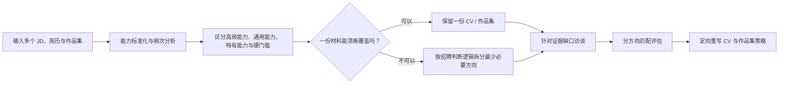

# JD 翻译官（JD Translator）

> English: An agent skill that turns multiple job descriptions into an executable application strategy for product/UX designers — clustering JD requirements, filtering out generic baseline skills, deciding how many CV/portfolio versions you actually need, running evidence interviews, and rewriting targeted CVs.

一个面向产品设计师、UX/UI 设计师的求职分析 Skill。它不会把招聘要求简单改写成关键词，而是把多个 JD 聚类为可执行的投递方向，再完成证据访谈、匹配评估、简历重写和作品集调整。

## 它解决什么问题

同时投递多个岗位时，常见问题不是“简历写得不够多”，而是：

- 不知道多份 JD 里哪些能力真正高频、哪些只是设计师基础能力。
- 只看到关键词差异，没有判断低频能力是不是硬门槛。
- 不确定一份简历能否覆盖，容易过度制作多个版本。
- 项目经历存在，但缺少结果、角色边界或目标岗位需要的表达。
- 分析报告、简历和作品集各说各话，没有共用的事实底稿。

JD 翻译官把这些问题组织成一条连续工作流。

## 核心工作流



### 1. 多 JD 能力地图

- 合并同义要求，不直接按关键词计数。
- 区分高频岗位能力、设计师通用能力、方向特有能力、工作方式、硬门槛和加分项。
- 低频能力不会被自动删除；如果它决定录用或项目类型，会先向用户确认。

### 2. 材料分版决策

- 默认先验证一份简历是否足够。
- 只有定位冲突、核心能力不同、首选案例不同或硬门槛不同，才建议拆分。
- 多个版本可以调整能力项、摘要和项目组合，不只是改变顺序。

### 3. 证据访谈

- 区分已证明、待证明、可迁移、真实缺口和硬门槛风险。
- 用户只需提供口语化事实，Skill 负责整理成项目证据。
- 无法回忆项目时，可先基于公开产品资料生成待确认草稿；未经确认的内容不能写进最终 CV。

### 4. 匹配报告

- 报告是决策工具，不是固定流程。
- 单岗位且证据充分时只输出简版结论。
- 多岗位需要分流或证据缺口较多时，才生成完整的分方向报告。

### 5. CV 与作品集重写

- 使用同一份事实底稿，避免不同版本互相矛盾。
- 项目按照“业务场景 → 行动与判断 → 结果”表达。
- 默认控制为一页 A4，必要时最多两页。
- 保持“工作经历 → 公司 → 重点项目 → 项目描述 → 我的成就”的嵌套层级。

## 安装

将 `jd-translator` 文件夹复制到对应客户端的 Skills 目录，例如：

```bash
# Codex
cp -R jd-translator ~/.codex/skills/jd-translator

# Claude Code
cp -R jd-translator ~/.claude/skills/jd-translator
```

重新打开客户端后即可调用。

> 本 Skill 遵循 Agent Skills 开放规范，适用于 Codex、Claude Code、Kimi Code 等支持 Skills 的客户端；如果你的 Skills 目录不同，请复制到当前客户端实际使用的 Skills 根目录。

## 使用方式

显式调用：

```text
使用 $jd-translator 分析以下 5 个产品设计岗位。
先提炼高频能力并区分通用能力，判断我需要准备几份简历；
信息不足时向我提问，确认后再重写 CV。
```

也可以直接提供：

- 多个招聘页面或 JD 原文。
- 现有简历、作品集或项目说明。
- 目标地区、远程要求、语言与工作许可情况。
- 项目数据、复盘材料或用户研究结论。

## 典型输出

- 多 JD 能力地图。
- 一份或多个求职方向的决策建议。
- 证据补充问题与事实底稿。
- 分方向匹配报告。
- 一页优先、最多两页的定向 CV。
- 作品集案例选择、顺序与首页叙事。
- HTML、Markdown 或 PDF 版本的匹配报告。

## 判断原则

- 先讲业务能力，再讲设计技能。
- 高频不等于重要，低频不等于可以忽略。
- 不把通用设计流程包装成差异化优势。
- 区分“候选人没有能力”和“现有材料没有证明”。
- 不把相邻行业经验伪装成直接行业经验。
- 不创造项目、职责、指标、语言能力或工作资格。
- 所有量化结果都应能解释口径、周期和个人贡献。

## 隐私与公开使用

仓库不包含真实简历、姓名、联系方式、内部 OKR、未公开业务数据或公司内部材料。

使用者在提供材料前应：

- 删除身份证件、住址、电话、私人邮箱等身份信息。
- 确认项目数据是否允许写入简历或发送给第三方模型。
- 将内部项目名、客户名和未公开指标替换为泛化描述。
- 对公开求职材料进行最终人工检查。

## 目录结构

```text
.
├── README.md
├── SKILL.md
├── LICENSE
├── agents
│   └── openai.yaml
└── references
    ├── capability-clustering.md
    ├── evidence-interview.md
    └── report-and-cv.md
```

## 适用范围

当前规则主要针对产品设计、UX、交互、增长、AI 工具、金融交易、电商及全球化岗位。其他职业可以借用能力聚类和证据访谈框架，但 CV 的专业判断规则需要另行适配。

## 免责声明

Skill 输出用于求职决策和材料准备，不代表企业录用结果。用户应对最终简历内容的真实性、保密性和数据披露负责。

## License

[MIT](LICENSE)
